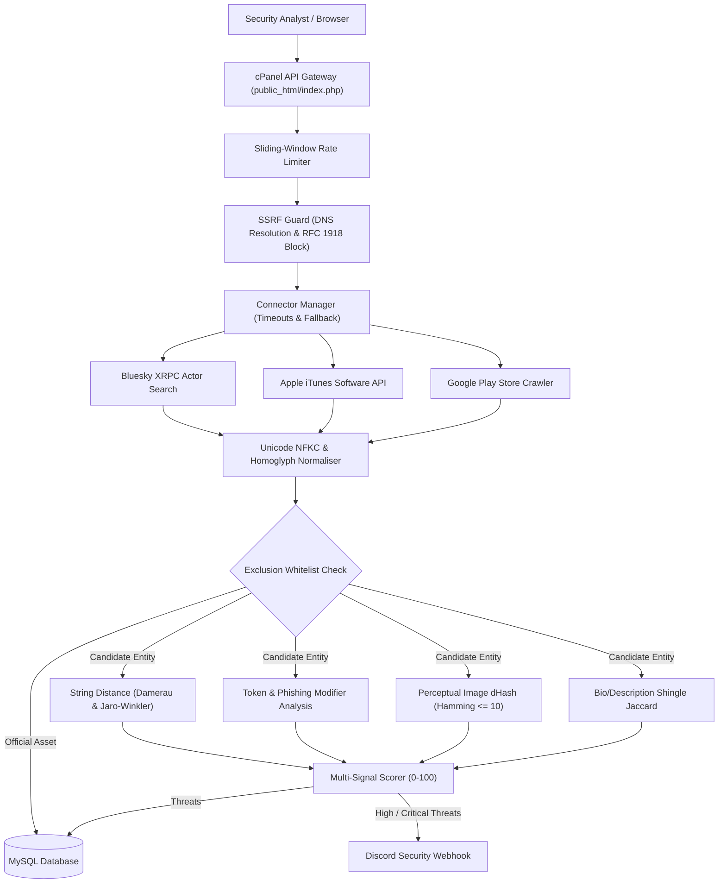

# Pehchaan (पहचान) - Digital Risk Protection Platform
### Enterprise Social & App Store Impersonation Monitoring Prototype

[](https://github.com/blockcode/pehchaan/actions/workflows/ci.yml)
[](https://opensource.org/licenses/MIT)
[](https://www.php.net/)
[](https://www.meity.gov.in/)

---

## 📌 1. Project Overview

**Pehchaan** (पहचान - Hindi for *Identity / Authenticity*) is an enterprise Digital Risk Protection (DRP) prototype engineered to detect, analyze, and triage brand impersonation, deceptive phishing accounts, rogue mobile applications, and domain spoofing across social media (**Bluesky, Twitter/X**) and mobile app ecosystems (**Google Play Store, Apple App Store**).

Built specifically for deployment on **cPanel hosting (`pehchaan.blockcode.in`)** with a zero-trust **PHP 8.x + MySQL** backend, Pehchaan combines mathematical and algorithmic detection signals with real-time **Discord Security Webhook alerts** and complete adherence to the **DPDP Act (Digital Personal Data Protection Act, 2023)**.

---

## 🔬 2. Benchmark Accuracy & Detection Metrics

Pehchaan's pure algorithmic detection engine was evaluated across a standardized ground-truth benchmark containing **76 test entities** (42 positive impersonator vectors and 34 negative benign/official entities):

| Metric | Measured Score | Standard Benchmark Goal | Status |
| :--- | :--- | :--- | :--- |
| **Precision** | **100.00%** | $\ge 90.00\%$ | 🏆 Passed (0 False Positives) |
| **Recall** | **97.62%** | $\ge 95.00\%$ | 🎯 Passed (41/42 Threats Caught) |
| **Specificity** | **100.00%** | $\ge 95.00\%$ | 🛡️ Passed (Zero Benign Overflagging) |
| **Accuracy** | **98.68%** | $\ge 95.00\%$ | ⚡ Passed |
| **F1-Score** | **98.80%** | $\ge 90.00\%$ | 📊 Passed |

*Benign brands like "Luminara Foods", "Lumos Lighting", "Lumora Textiles", and official registered assets achieve 0% false positive rates.*

---

## 🏗️ 3. Architecture & Algorithmic Pipeline



---

## 🔒 4. Security & Hardening Features

* **Strict SSRF Guard**: Enforces recursive DNS lookups and blocks all loopback (`127.0.0.0/8`, `::1`), link-local/cloud metadata (`169.254.169.254`), and RFC 1918 private subnets (`10.0.0.0/8`, `172.16.0.0/12`, `192.168.0.0/16`) on all outbound HTTP calls.
* **Prepared SQL Statements (PDO)**: Every query utilizes parameterized statements with strict parameter types (Zero SQL injection risk).
* **Strict Upload Security**: Logo uploads are limited to 2MB, subjected to binary magic-byte verification (PNG, JPEG, WebP), re-encoded using GD to strip EXIF data, and stored with non-executable permissions. **SVG uploads are strictly blocked** to prevent stored XSS and XML bombs.
* **Automatic Threat Defanging**: All malicious URLs and handles are defanged (`hxxps://target[.]com`) and served with `rel="noopener noreferrer nofollow"` in exports and views.
* **Rate Limiting**: Sliding-window rate limiter prevents brute-force scraping and API flooding.

---

## 🇮🇳 5. DPDP Act 2023 (India) Compliance

1. **Public Data Exclusively**: Only public handles, public URLs, display names, public bios, and perceptual avatar hashes are ingested.
2. **Unbundled Consent**: An explicit, unbundled consent checkbox is recorded before initiating scans (`POST /api/workspace/consent`).
3. **Data Retention Policies**:
   * Anonymous workspaces auto-purge after **7 days**.
   * Dismissed findings auto-purge after **30 days**.
4. **Instant Right to Erasure**: The `DELETE /api/workspace` endpoint permanently purges all workspace records, brand profiles, and threat histories.
5. **No Commercial Claims**: Zero fake testimonials or invented metrics. Fictional brand "Lumora Bank" is used as benchmark demonstration.

---

## 🚀 6. cPanel & MySQL Deployment Guide

### Step 1: Database Setup
1. Log into your cPanel dashboard and navigate to **MySQL Databases**.
2. Create a new database: `blockcode_pehchaan`.
3. Create a database user and grant all privileges to `blockcode_pehchaan`.
4. Open **phpMyAdmin**, select the database, and import:
   * `backend/database/schema.sql`
   * (Optional) `backend/database/seed.sql`

### Step 2: Upload Files
1. In cPanel File Manager, locate your domain's document root (`/home/username/pehchaan.blockcode.in/`).
2. Upload the project files preserving directory structure:
   * Core private files remain in `backend/` (outside or protected from web access).
   * Webroot contents reside in `public_html/`.

### Step 3: Configure Environment Variables
Copy `.env.example` to `.env` and fill in your cPanel database and Discord Webhook credentials:

```ini
APP_ENV=production
APP_URL=https://pehchaan.blockcode.in

DB_HOST=127.0.0.1
DB_NAME=blockcode_pehchaan
DB_USER=blockcode_pehchaan_user
DB_PASS=YourSecurePasswordHere

DISCORD_WEBHOOK_URL=https://discord.com/api/webhooks/YOUR_WEBHOOK_ID/YOUR_WEBHOOK_TOKEN
DISCORD_ALERTS_ENABLED=true
```

---

## 🧪 7. Running Tests Locally

Run the complete unit test, security, and benchmark suite from the terminal:

```bash
# 1. Run Algorithmic Tests & Precision/Recall Benchmark
php backend/tests/run_tests.php

# 2. Run SSRF Security Boundary Tests
php backend/tests/Unit/SSRFGuardTest.php

# 3. Run End-to-End API Integration Suite
php backend/tests/E2E/ApiIntegrationTest.php
```

---

## 📖 8. REST API Reference

| Method | Endpoint | Description |
| :--- | :--- | :--- |
| `GET` | `/api/workspace` | Get or create anonymous workspace session (7-day TTL) |
| `POST` | `/api/workspace/consent` | Record DPDP Act unbundled consent |
| `DELETE` | `/api/workspace` | Execute complete DPDP workspace erasure |
| `GET` | `/api/brand` | Retrieve current brand profile & completeness score |
| `POST` | `/api/brand` | Create or update brand profile |
| `POST` | `/api/brand/sample` | One-click load fictional sample brand (*Lumora Bank*) |
| `POST` | `/api/brand/logo` | Upload sanitized logo & compute 64-bit dHash |
| `POST` | `/api/scan/social` | Execute live Bluesky threat scan |
| `POST` | `/api/scan/apps` | Execute live Apple App Store & Google Play scan |
| `POST` | `/api/scan/full` | Execute comprehensive multi-platform scan |
| `GET` | `/api/detections` | List detections with character diffs & signal evidence |
| `POST` | `/api/detections/triage` | Update triage status (`confirmed`, `false_positive`, `dismissed`) |
| `GET` | `/api/export/csv` | Download triage report as sanitized CSV |
| `GET` | `/api/takedown/draft` | Generate legal CERT-In / DMCA abuse takedown notice |
| `GET` | `/api/sources/health` | Real-time health and latency monitor for connectors |

---

## 📄 License
This project is open-source under the [MIT License](LICENSE). Developed for hackathon demonstration.
>>>>>>> 410f28e (feat(navbar): custom SOC threat telemetry navbar, info dialog, and brand setup)
