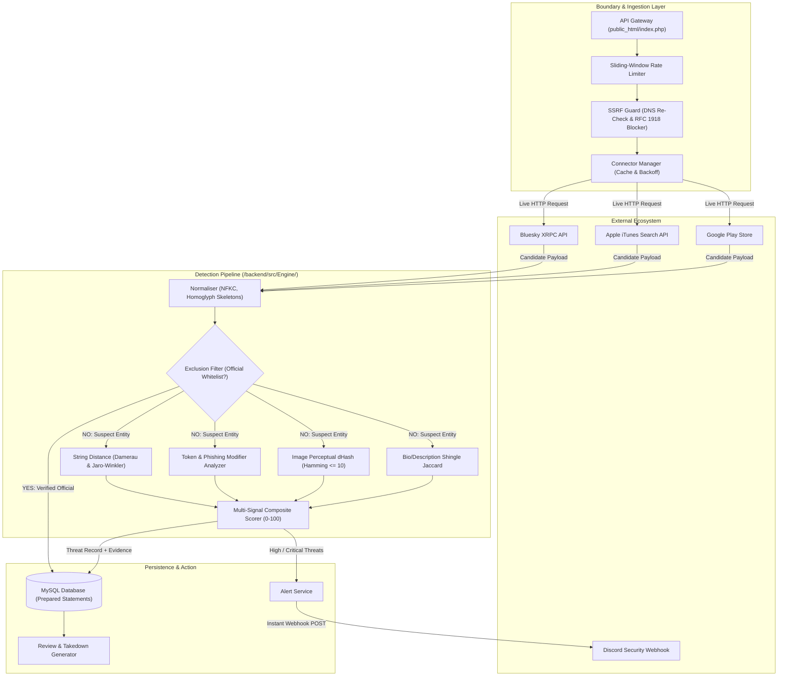

# Pehchaan (पहचान) - System Architecture & Pipeline Specification

## 1. Architectural Overview

Pehchaan is structured into five core decoupled layers:
1. **API Gateway & Boundary Security**: Rate limiting, HTTP Strict Transport Security, strict Content Security Policy, and SSRF outbound validation.
2. **Data Ingestion & Threat Connectors**: Resilient connectors querying live external threat feeds (Bluesky XRPC actor search, Apple iTunes Software Search API, Google Play Store search).
3. **Pure Algorithmic Detection Engine**: Mathematical analysis pipeline implementing Unicode NFKC normalization, homoglyph skeleton mapping, Damerau-Levenshtein distance, Jaro-Winkler similarity, phishing keyword modifier analysis, perceptual difference hashing (dHash), and shingle Jaccard overlap.
4. **Official Asset Whitelist & Exclusion Engine**: Multi-tiered exclusion check guaranteeing zero self-flagging for verified brand assets.
5. **Storage, Alerting & Triage**: MySQL database with strict prepared statements, Discord Webhook incident dispatching, CSV export, and legal abuse notice generation.

---

## 2. End-to-End Data Flow Diagram

---

## 3. Official Asset Whitelist & Exclusion Step

To prevent brands from receiving false alarms regarding their own legitimate accounts, apps, and domains, Pehchaan implements an **Exclusion Filter** prior to threat scoring:

1. **Exact Handle / ID Equality**: If `Normaliser::stripSeparators(candidate.external_id)` matches any verified official asset, the entity is tagged as `Official Verified` (Score: 0, Severity: LOW) and excluded from alerts.
2. **Domain Matching**: Subdomain or exact host comparisons against the brand's verified domain list.
3. **Authorized Developer Check**: App store developers matching the official registered entity are marked authentic.
4. **Workspace Allowlist**: Items previously reviewed by the security team and triaged as `false_positive` are persisted in the workspace allowlist.

---

## 4. Multi-Signal Scoring Heuristics

To prevent over-flagging single coincidental word matches, the scoring engine enforces a multi-signal rule:
* **High Severity ($\ge 60$)** and **Critical Severity ($\ge 80$)** strictly require **$\ge 2$ independent algorithmic signals** (e.g., Lexical Edit Distance + Phishing Modifier or Homoglyph + Logo Clone).
* Single-signal coincidences are capped at Medium or Low severity.
* Generic industry dictionary terms (e.g. `foods`, `lighting`, `textiles`, `pharmacy`, `logistics`) trigger a suppression penalty unless accompanied by verified trademark impersonation.
